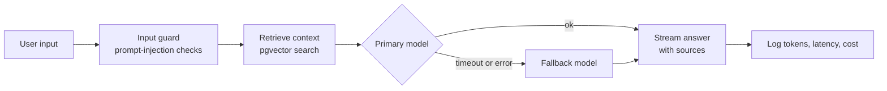

<h1 align="center">Nidhi Kumari</h1>

<p align="center">
  <b>Software engineer building LLM systems that flaunts gracefully, and the full-stack products around them.</b><br/>
  RAG · bounded agents · async AI pipelines · React / Node.js / Postgres
</p>

<p align="center">
  <a href="https://linkedin.com/in/nidhi6669">LinkedIn</a> ·
  <a href="mailto:nidhikumari.professional@gmail.com">Email</a> ·
  Bengaluru, India
</p>

---

```ts
const nidhi = {
  role: "Software Development Engineer @ Story Commerce",
  building: "AI pipelines that review creator videos at scale",
  focus: ["LLM systems", "full-stack products", "system design"],
  stack: {
    web:   ["React", "Next.js", "TypeScript", "Tailwind"],
    api:   ["Node.js", "Express", "REST", "SSE", "WebSockets"],
    data:  ["PostgreSQL", "pgvector", "MongoDB"],
    cloud: ["AWS (Lambda, S3, Bedrock)", "Docker", "Vercel", "Cloudflare"],
  },
  motto: "An AI feature isn't done until you know how it breaks.",
};
```

## How I build AI features



- **Ground it.** Answers come from retrieved data and cite their sources.
- **Never one model.** Every call has a fallback provider (Gemini → Groq, OpenAI → Gemini).
- **Bound the agent.** AI drafts; a human approves anything irreversible.
- **Go async.** Long-running work moves to queues so uploads never wait on processing.
- **Measure it.** Token usage, latency and outcomes are tracked, not guessed.

## Featured projects

| | Project | What makes it interesting |
|---|---|---|
| 🛡️ | [**triage-agent**](https://github.com/builtbynidhi/triage-agent) | A support-ticket agent that drafts policy-grounded replies and refuses to act without a human. Built to be measured. |
| 🔮 | [**Shubhmilan-AI**](https://github.com/builtbynidhi/Shubhmilan-AI) · [live](https://shubhmilan-ai.vercel.app) | Biodata, kundli and palm-reading platform: RAG retrieval, serverless APIs on Neon Postgres, Razorpay payments, PDF generation. |
| 💼 | [**creator-board-app**](https://github.com/builtbynidhi/creator-board-app) · [live](https://creator-board-app-cfp3.vercel.app/) | Job board where AI writes the job posting for you. |

## Built in production

- **Creator verification pipeline:** speech-to-text (AssemblyAI), computer vision (OpenCV, FFmpeg) and a video-understanding model check influencer videos for compliance end to end, replacing manual review.
- **Async video evaluation on AWS:** Bedrock-based scoring with real-time submission tracking and AI-written feedback reports.
- **Campaign assistant on Claude:** configures briefs and writes creator scripts; campaign setup is 60% faster.
- **GitHub project evaluator:** an AI tool that extracted and assessed projects for 600+ students at Newton School.

## Toolbox

<p>
  
</p>

<sub>Also: LangChain · OpenAI / Claude / Gemini / Groq APIs · Supabase (RLS) · JWT, OAuth 2.0, RBAC · OWASP Top 10 · Certified: Claude Code in Action (Anthropic)</sub>
