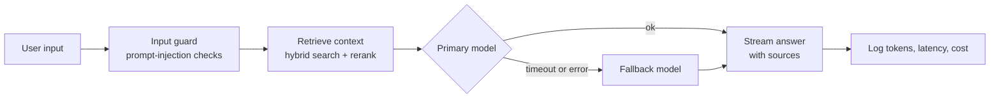

<h1 align="center">Nidhi Kumari</h1>

<p align="center">
  <b>Software engineer who builds and ships production AI features.</b><br/>
  LLM applications · RAG · bounded agents · MCP · full-stack on React.js / Node.js / PostgreSQL
</p>

<p align="center">
  <a href="https://nidhi-portfolio-brown.vercel.app"><b>Portfolio</b></a> ·
  <a href="https://linkedin.com/in/nidhi6669">LinkedIn</a> ·
  <a href="mailto:nidhikumari.professional@gmail.com">Email</a> ·
  Agra, India · open to remote / Bengaluru / Delhi NCR
</p>

<p align="center">
  <b>Open to AI Engineer and Full-Stack AI roles.</b>
</p>

---

```ts
const nidhi = {
  recently: "SDE @ Story Commerce — joined as an intern, promoted to SDE",
  shipped:  "4 AI products end to end in 2026, including a live paid application",
  focus:    ["LLM systems", "RAG & retrieval", "bounded agents", "system design"],
  stack: {
    ai:    ["RAG", "MCP", "LangChain", "LangGraph", "Claude / Gemini / Groq / OpenAI", "AWS Bedrock"],
    web:   ["React", "Next.js", "TypeScript", "Tailwind", "Chrome MV3"],
    api:   ["Node.js", "Express", "FastAPI", "REST", "SSE", "WebSockets"],
    data:  ["PostgreSQL", "pgvector", "SQLite FTS5", "MongoDB", "Drizzle"],
    cloud: ["AWS (EC2, S3, Lambda, Bedrock)", "Docker", "Vercel", "Cloudflare"],
  },
  motto: "An AI feature isn't done until you know how it breaks.",
};
```

## How I build AI features



- **Ground it.** Answers come from retrieved data and cite their sources.
- **Never one model.** Every call has a fallback provider (Gemini → Groq, OpenAI → Gemini).
- **Bound the agent.** Step, tool-call and token budgets; AI drafts, a human approves anything irreversible.
- **Keep logic in code.** Deterministic work stays deterministic; the LLM explains, it doesn't compute.
- **Go async.** Long-running work moves to queues so uploads never wait on processing.
- **Measure it first.** Eval suites before features; tokens, latency and outcomes tracked, not guessed.

## Featured projects

| | Project | What makes it interesting |
|---|---|---|
| 🛡️ | [**triage-agent**](https://github.com/builtbynidhi/triage-agent) | A bounded support-triage agent: a state machine with step, tool-call and token budgets that reaches data only through an MCP server, returns clause-cited decisions and fails closed to human escalation. Hybrid retrieval (FTS5 + vector + cross-encoder rerank) measured at **96.9% hit@4** vs 71.9% keyword-only; 40-case eval suite written before the agent, plus 200+ tests that need no API keys. |
| 🔮 | [**Shubhmilan-AI**](https://github.com/builtbynidhi/Shubhmilan-AI) · [live](https://shubhmilan-ai.vercel.app) | A live, paid full-stack AI product. Two-pass palm reading — a vision model detects features, then RAG over an embedded knowledge base writes a source-cited reading — plus AI biodatas and OCR prefill. Kundli and 36-point compatibility computed in deterministic code; Clerk auth and server-verified Razorpay payments. |
| 🧩 | [**Workday Autofill Assistant**](https://github.com/builtbynidhi/AI-Powered-Chrome-Extension) | A Manifest V3 Chrome extension with a FastAPI backend that parses PDF/DOCX resumes and uses LangGraph + Gemini to map **only** the ambiguous fields, filling the rest in code. Safety enforced in code: prefilled values are kept, AI answers require review, submit stays explicit. 54 tests pass with no live AI calls. |
| 🥗 | [**MealMind**](https://github.com/builtbynidhi/MealMind) | A RAG meal-planning pipeline on Next.js and pgvector with Gemini 2.5 Flash and Groq failover, Supabase Auth, row-level security and prompt-injection protection. |

## Built in production

At **Story Commerce** (Jan – Aug 2026) and **Newton School** (Dec 2025 – Apr 2026):

- **Campaign assistant on Claude:** configures campaign briefs and writes creator scripts inside a full-stack influencer platform (React, Node.js, Supabase) — campaign setup 60% faster.
- **Creator verification pipeline:** speech-to-text (AssemblyAI), computer vision (OpenCV, FFmpeg) and a video-understanding model check influencer videos for compliance end to end, replacing manual review.
- **Async video evaluation on AWS:** Bedrock-based scoring with real-time submission tracking and AI-written feedback reports.
- **GitHub project evaluator:** an AI tool that extracted and assessed projects for 600+ students, cutting instructor review effort.

## Toolbox

<p>
  
</p>

<sub>Also: RAG · MCP · LangChain · LangGraph · embeddings & hybrid retrieval · prompt engineering & injection defense · LLM evaluation · AWS Bedrock · Supabase (RLS) · Neon · Nginx · JWT, OAuth 2.0, RBAC · OWASP Top 10 · HLD/LLD, caching, queues, rate limiting</sub>

<sub>MCA, Jain University (2023–2025) · B.Sc., Dayalbagh Educational Institute (2019–2022) · Certified: Claude Code in Action (Anthropic)</sub>
